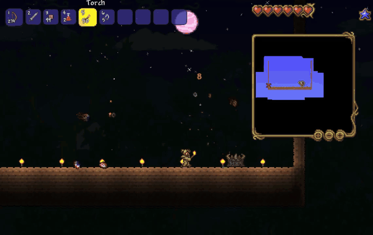

# Teaching AI to beat Terraria

The goal is to start with a fresh character in any world and beat the Moon Lord without a human ever taking the controls.

This repo contains the pieces of a Terraria agent harness for real-time play and long-horizon planning.

- [AgentIO](mod/AgentIO), the tModLoader mod that reads game state and sends controls to Terraria.
- **Agent harness**. The [live brain](live-brain) handles real-time play by mapping terrain, finding routes, and simulating moves. The [slow brain](slow-brain) plans ahead and chooses the next goal.
- [Gym](gym/live-brain), 70 numbered scenarios that check what the agent does in the game.



[Watch the original gameplay clip on X](https://x.com/hamudinaanaa/status/2112038383291932896)

[Watch the YouTube walkthrough](https://youtu.be/dGvCWJzEPVg)

## What’s here today

The live brain can travel, mine, build, collect items, fight, craft and interact with doors and chests. The Gym includes 70 numbered scenarios, nine episodes copied from real play, and separate enemy and weapon tests. Runs record the state, candidate moves, chosen inputs and timings.

This live brain has won prepared fights against the Eye of Cthulhu, Wall of Flesh and nighttime Empress of Light. We supplied the gear, arenas and goals for those fights. The [slow-brain instructions](slow-brain) let a fresh coding-assistant subagent choose goals from the actual game state and feed them to the live brain.

## Set up AgentIO

You'll need Terraria and tModLoader, the .NET 8 SDK to build the mod, and Python 3.10 or later for the live brain. The Python code uses the standard library. Tested on macOS with Terraria 1.4.4.9, tModLoader 2026.09.3.1, and Python 3.11.

1. Launch tModLoader. Open **Workshop → Develop Mods → Open Sources**.
2. Copy the whole `mod/AgentIO` folder into the opened `ModSources` folder. Return to **Develop Mods** and choose **Build + Reload** for AgentIO. Enable it in **Manage Mods** if needed. [tModLoader build guide](https://github.com/tModLoader/tModLoader/wiki/Basic-tModLoader-Modding-Guide)
3. Create a disposable Journey character and a small Journey world named exactly `Gym`. Enter it in single-player mode, with the game language set to English. Leave Godmode off and set the Journey enemy difficulty slider to **1.5×**, the setting used to verify the scenarios. The Gym replaces the character's inventory and stamps terrain for each scenario.
4. From the project folder, check that AgentIO is responding and run a smoke test.

```sh
curl http://127.0.0.1:17900/ping
python3 gym/live-brain/run.py --watch 1
```

Keep the game running while the tests play. AgentIO listens on loopback at `127.0.0.1:17900`. Its local clients can control the game and change inventory or terrain.

## Run the Gym

```sh
python3 gym/live-brain/run.py --list
python3 gym/live-brain/run.py --watch 65 66 67
python3 gym/live-brain/run.py all
python3 gym/live-brain/checks.py
python3 gym/combat/weapons.py
python3 gym/combat/observed_motion.py
```

`regular` selects cases 1–12, `extended` selects 13–70, and `all` selects those 70 cases. `recorded` runs the [episodes copied from real playthroughs](gym/episodes). You can also pass names such as `ammo_fallback`. `--watch` displays the case number and result in the game. `--no-overlay` suppresses drawings. Each run writes its summary and per-case JSONL logs to `runs/`. The component checks in `checks.py` run without the game. Add `--gym` to also check command scheduling and cancellation against AgentIO in Gym.

The [combat Gym](gym/combat) covers 18 common-enemy cases and 29 weapon cases, with individual case selection and optional recording. It also contains the collector used to compare scripted inputs with the live brain. These suites run separately from the 70 numbered scenarios.

The loop plans replacement inputs 15 game ticks ahead, about 250 ms when the game runs at 60 ticks per second. It measures each step and shares repeated movement predictions within that round. AgentIO checks the actual game tick before accepting an input script.

## Let an agent plan the game

Ask your coding assistant to follow [slow-brain/README.md](slow-brain/README.md) to start or resume a game. It covers launching a fresh planning subagent with **high reasoning** and keeping the live brain supplied with goals.

## Give the live brain a goal

Save a goal in `goal.json`. This example asks the character to stand at tile `(2720, 209)`, with a budget of 900 game ticks. Choose coordinates appropriate for the loaded world.

```json
{"kind": "reach", "cell": [2720, 209], "limit_ticks": 900}
```

```sh
python3 live-brain/loop.py --world Gym goal.json
```

The loop reads AgentIO, updates the map, asks Pathfinder for a route, and sends the move selected by the fast brain. It writes decisions and a final result to standard output. The Gym scenarios also show goal examples for terrain changes, item counts, combat, interactions, searches, and waiting.

Consumables use an interaction goal, for example `{"kind":"interact","operation":"use","item":"Recall Potion","consume":1,"limit_ticks":180}`. Completion requires observing the item count decrease. Summon goals instead check for owned projectiles; see the [combat Gym](gym/combat).

## Current limits

- Enemy and hostile-projectile forecasts continue the motion visible in the current state. Sudden turns, launches and newly spawned attacks can still surprise the agent. The live brain requests the game's current projectile collision shapes in both Gym and ordinary worlds.
- A combat goal currently leaves the fighting area unrestricted. The agent can leave an arena, and boss wins are still inconsistent. The prepared boss takes use local setup scripts; the public combat collector includes short boss probes.
- Automatic inventory dropping, underwater lighting alternatives and returning to a journey after digging an air pocket still need work. Continuous beams and multi-shot weapons need more checks.

## Why

I’m building this harness to test how agents pursue long-term goals with incomplete information. The research goal is to use what we learn to build agents that can work toward human goals over months, where progress is harder to measure.

Terraria is a good proxy for it. The agent discovers the world as it explores, random events can change its plans, and there’s more than one way to reach the same goal. Surprisingly, it's a great agent gym to compare strategies across millions of runs.

And it’s just a lot of fun.
